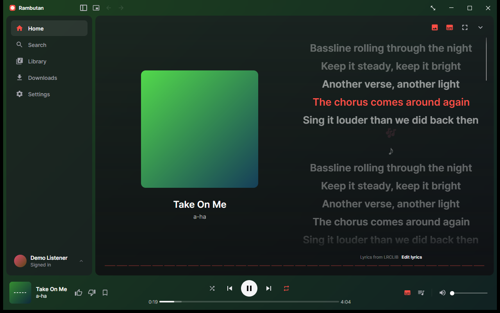
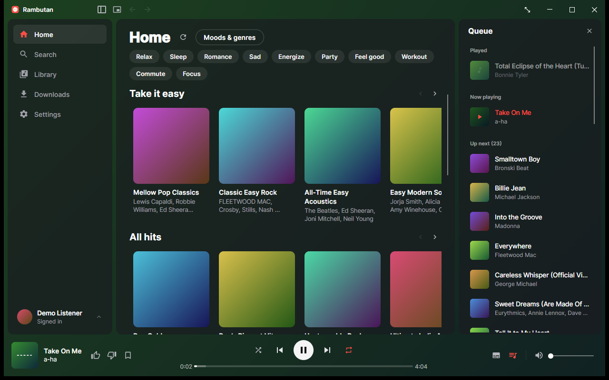
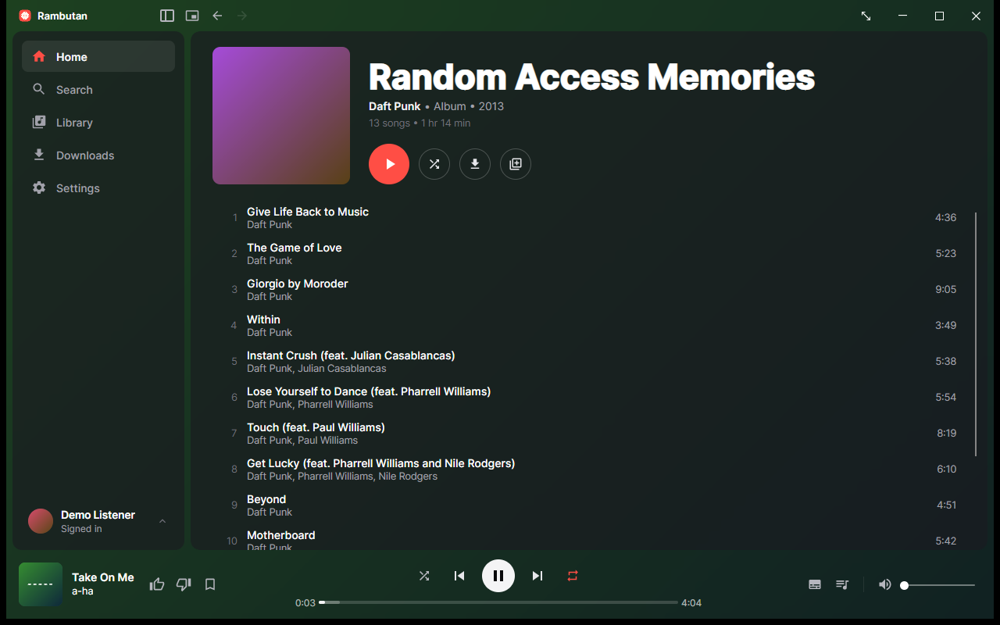
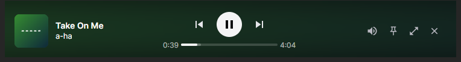

<p align="center">
  
</p>

<h1 align="center">Rambutan Music Player</h1>

<p align="center">
  A fast, native desktop app for YouTube Music, for Windows and Linux.
</p>

<p align="center">
  <a href="https://github.com/ophionos/Rambutan/releases">Download</a> ·
  <a href="#features">Features</a> ·
  <a href="#install">Install</a> ·
  <a href="#settings">Settings</a> ·
  <a href="CONTRIBUTING.md">Contribute</a>
</p>

<p align="center">
  
</p>

Rambutan plays your YouTube Music library, playlists and recommendations in a
real desktop app, not a website in a window. It opens in under half a second,
stays light on memory while it plays, and fits into your desktop: media keys,
the system's media controls, a tray icon and a mini player.

Around the music it adds what a desktop player should have: lyrics that
follow the song, a visualizer, an equalizer, crossfade, downloads you can play
offline, a remote on your phone and an overlay for your stream.

Rambutan is not affiliated with, or endorsed by, Google or YouTube. You need
your own YouTube Music account to use your library.

## Features

**Listen**
- Search, Home, Moods & genres, albums, artists, playlists, radio and your
  library, with likes, saves and playlist editing.
- Gapless playback, crossfade, volume normalization and a 10-band equalizer.
- A queue you can reorder, restored when you start the app again.
- A choice of output device.

**Now Playing**
- The artwork and the lyrics side by side, or either one alone, over a
  visualizer that fills the pane. Fullscreen, for a second screen or a party.
- Synced lyrics, with a word-by-word karaoke sweep where word timing exists.
  Import your own lyrics, or adjust their timing in the app.
- Eight visualizer styles in your accent colour or the artwork's, and an
  optional set of animated presets.

**Offline**
- Download songs, albums and playlists, and play them with no connection.
- Export downloads as ordinary audio files, if you want them elsewhere too.

**Beyond the window**
- **Phone remote:** control playback, the volume and the queue from your
  phone's browser, and search for songs to play. You pair a phone by scanning
  a QR code, and the remote works only on your local network.
- **OBS overlay:** show what is playing on your stream, in a style you edit
  in the app.
- **Last.fm:** scrobbling, plus your Last.fm stations on Home and on artist
  pages.
- **Discord:** show what you are listening to in your status.

**Your desktop**
- Media keys and the system's media controls (Windows media overlay, MPRIS on
  Linux), and a tray icon.
- A mini player that can stay on top of other windows.
- Keyboard shortcuts for everything (press F1 to see them), screen-reader
  names on every control, and a reduced-motion mode.
- Profiles, each with its own sign-in, settings, queue and downloads.

**Private by default.** Everything that sends data off your computer is off
until you turn it on: Last.fm, Discord, online lyrics lookups and the phone
remote. Each setting says exactly what it sends. There is no telemetry.

<table>
  <tr>
    <td></td>
    <td></td>
  </tr>
  <tr>
    <td align="center">Home, with the queue</td>
    <td align="center">An album</td>
  </tr>
</table>

<p align="center">
  <br>
  The mini player
</p>

<sub>Screenshots are from the app's demo mode, which uses placeholder artwork.</sub>

## Install

Download the newest build from
[Releases](https://github.com/ophionos/Rambutan/releases).

### Windows 10 and 11

Run the `Setup.exe`, or unzip the portable build. The installer is not
code-signed, so Windows SmartScreen warns first: choose **More info**, then
**Run anyway**.

### Linux (x64)

Download the `.AppImage`, make it executable (`chmod +x` on the file) and run
it. It needs:

- the PulseAudio client library (`libpulse`, which also works with PipeWire),
- fontconfig,
- fonts with CJK and emoji coverage, such as Noto.

Your sign-in goes into the system keyring (GNOME Keyring, KWallet or another
Secret Service). **If no keyring is running, the sign-in is stored
unencrypted**, in a file that only your user account can read. The sign-in
screen tells you which one applies.

### Sign in

Open **Sign in** in the app and follow its steps. In short: sign in to
music.youtube.com in a private browser window, open the developer tools, and
copy one request as cURL. Rambutan picks it up from the clipboard. Then close
the private window without signing out.

YouTube stops accepting a copied sign-in a day or two after Rambutan last ran.
To have Rambutan renew it by itself, also copy the request to
accounts.google.com from the same private window (the sign-in screen has an
optional step for it). Those cookies give access to your whole Google account,
not only YouTube; Rambutan sends them only to accounts.google.com and keeps
them the same way as the YouTube cookies.

### Updates

The app checks this repository for new builds and offers them in the status
strip at the bottom of the window.

## Settings

Everything is in **Settings**, in the sidebar. The sections are:

| Section | What you set there |
|---|---|
| Account | Your sign-in. |
| Appearance | The album-art tint, the visualizer's style, colour and frame rate, and motion. |
| Behavior | Whether closing the window keeps Rambutan running in the tray. |
| Playback | Crossfade, volume normalization, streaming quality, autoplay, the audio cache and the output device. |
| Equalizer | The 10-band equalizer. |
| Lyrics | Online lyrics lookups on LRCLIB (off until you turn them on). |
| Downloads | The download folder, and exporting downloads as audio files. |
| Phone remote | Turn the remote on and pair a phone. |
| OBS overlay | Turn the overlay on, copy its address, and edit its style. |
| Last.fm, Discord | Connect to Last.fm; turn on Discord and choose what it shows. |
| Language | The display language. |
| Updates | Check for a new build. |

To add a profile or switch to another one, open the account menu at the
bottom of the sidebar. Switching restarts the app.

Your settings, lyrics, logs and (unless you choose another folder) downloads
live in one folder:

- Windows: `%LOCALAPPDATA%\Rambutan`
- Linux: `~/.local/share/Rambutan`

Each profile other than the first has its own folder under `profiles/` in it.

**Limits:**
- You sign in by copying a request from your browser's developer tools. There
  is no Google sign-in page.
- The app is in English only.
- On Linux, the app has been checked on real hardware with one desktop so far
  (COSMIC on Wayland). On Wayland, the mini player can't stay on top of other
  windows, because Wayland doesn't allow it.

## Report a problem or an idea

Use the [issue forms](https://github.com/ophionos/Rambutan/issues/new/choose):
**Bug report** for something that does not work, **Feedback or idea** for
everything else. Please search the open issues first.

A bug report helps most with the end of the log file, `logs/rambutan.log` in
the folder above. The log holds no cookies or keys, but it can name tracks you
played.

If Rambutan crashes, it keeps a crash file on your computer. At the next start
it offers to open a bug report with that file filled in. Nothing is sent
until you submit the report yourself.

## Development

Rambutan is written in C# on .NET 10, with an [Avalonia](https://avaloniaui.net)
interface. Release builds are compiled ahead of time (NativeAOT).

You need:

- the [.NET 10 SDK](https://dotnet.microsoft.com/download);
- on Linux, the PulseAudio, Wayland and X11 client libraries, fontconfig and
  Noto fonts (the full list is in [CONTRIBUTING.md](CONTRIBUTING.md));
- for a release build, `clang` (and `zlib1g-dev` on Linux);
- only to change the phone remote or the OBS overlay, Node.js and npm.

```bash
dotnet build Rambutan.slnx -warnaserror
dotnet test --solution Rambutan.slnx
dotnet run --project src/Rambutan.App

# No account or network needed: recorded catalog, generated audio
RAMBUTAN_DEMO=1 dotnet run --project src/Rambutan.App
```

[CONTRIBUTING.md](CONTRIBUTING.md) explains how the code is laid out and what
a change needs before it can merge. Everyone who takes part follows the
[code of conduct](CODE_OF_CONDUCT.md).

## License

Copyright (C) 2026 Ophion and contributors.

Rambutan Music Player is free software: you can redistribute it and/or modify
it under the terms of the GNU General Public License as published by the Free
Software Foundation, either version 3 of the License, or (at your option) any
later version. See [LICENSE](LICENSE).

The components it includes keep their own licenses; see
[THIRD-PARTY-NOTICES.md](THIRD-PARTY-NOTICES.md).
